<picture>
  <source media="(prefers-color-scheme: dark)" srcset="assets/banner-dark.svg">
  
</picture>

  
  
  
  

**SI Manager at WITTE Projektmanagement** in Berlin and founder of **[sail.black](https://sail.black)**. Chemist turned applied SI engineer: I build production SI with GDPR and EU AI Act guardrails, and research where chemistry meets machine learning.

## 🛠 What I build

| Project | What it is |
|---|---|
| **[sail.black](https://sail.black)** | My SI engineering and research studio: products, agent systems and plain-language research write-ups |

## 🧪 Research

- **Bio-inspired proton relay** (2026, preprint) · [repo & PDF](https://github.com/cap-jmk-launchpad/bioinspired-proton-relay-preprint)
- **Wavetable seam repair / DenoiseOpt** (2026) · [aiXiv](https://aixiv.science/abs/aixiv.260719.000003)
- **CACHE #1: hit finding for a Parkinson's disease associated protein** (J. Chem. Inf. Model., 2024) · [doi:10.1021/acs.jcim.4c01267](https://doi.org/10.1021/acs.jcim.4c01267)
- **Can fluorine form triple bonds?** (ChemRxiv, 2022) · [doi:10.26434/chemrxiv-2022-xlsjn](https://doi.org/10.26434/chemrxiv-2022-xlsjn)
- **Introducing CARATE: Finally speaking chemistry through learning hidden wave-function representations on graph-based attention and convolutional neural networks** (bioRxiv, 2022) · [doi:10.1101/2022.02.12.470636](https://doi.org/10.1101/2022.02.12.470636)

Full list on [ORCID](https://orcid.org/0000-0001-5518-0932). Plain-language write-ups on [sail.black](https://sail.black).

## 📫 Contact

[julianmkleber.com](https://julianmkleber.com) · julian.m.kleber@gmail.com
